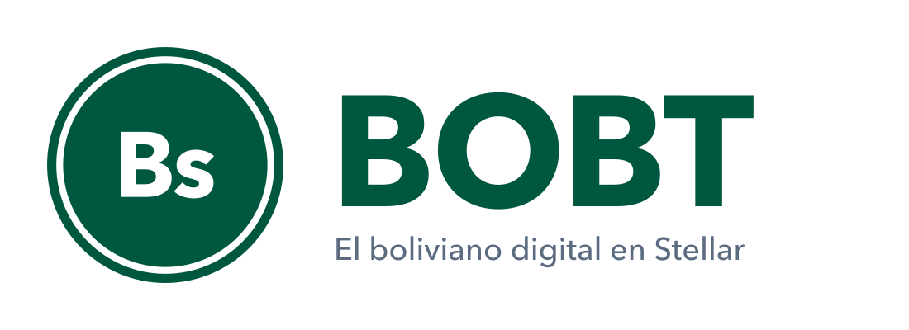

<p align="center"></p>

# BOBT: el boliviano digital en Stellar

**1 BOBT = 1 Bs**, respaldado 1:1 con bolivianos reales. Se compra con un QR, se cambia por USDC en segundos
dentro de Stellar y se canjea en el banco cuando se quiera.

Stellar conecta las monedas locales con el mundo a través de anchors. Argentina tiene ARST; Brasil, BRLT;
Bolivia no tenía ninguno. BOBT es el anchor boliviano: con los estándares SEP, cualquier wallet, remesadora o
app del mundo puede pagar y cobrar en bolivianos con una sola integración.

- Sitio: https://melodious-baklava-68ac6b.netlify.app
- Activo en la testnet: [BOBT en stellar.expert](https://stellar.expert/explorer/testnet/asset/BOBT-GATKWGAZCW4O63DJ6UB7YI3K3LOW4FFJ2LMMDIOIKZQV5JOC4NMFRIKH)

## Cómo funciona

| Flujo | Qué pasa |
|---|---|
| Depositar | Pagas un QR en Bs y el emisor acuña la misma cantidad de BOBT |
| Cambiar | BOBT y USDC se cambian en el exchange de Stellar, a cualquier hora |
| Recibir | Alguien en cualquier país envía USDC y llega como BOBT en una sola operación (path payment) |
| Retirar | Devuelves BOBT, recibes Bs en tu banco y los tokens se destruyen |

El cumplimiento vive en el protocolo: el emisor tiene `AUTH_REQUIRED`, `AUTH_REVOCABLE` y
`AUTH_CLAWBACK_ENABLED`, así que solo cuentas verificadas reciben BOBT y, ante un fraude, se congela y se
recupera.

## Probar la demo

Requiere Node 22 o superior. Todo corre en la testnet de Stellar; el banco y las reservas están simulados.

```sh
cd demo
npm install
npm run demo     # crea cuentas, el activo y el mercado BOBT/USDC, y corre todos los flujos
npm start        # demo web en http://localhost:4321
```

Detalle de cada paso en [`demo/README.md`](../demo/README.md).

## Estructura

| Carpeta | Qué hay |
|---|---|
| `demo/` | Scripts de los flujos con el Stellar SDK y la demo web local |
| `sitio/` | La página del proyecto (HTML estático; lee la red en vivo) |
| `marca/` | Logo, ícono y paleta |

## Estado

Prototipo en testnet, presentado en la Ideatón Stellar Bolivia 2026. BOBT no recibe dinero real hasta operar
con un emisor autorizado por la ASFI (un PSAV o un banco socio), con reservas 1:1 en una cuenta separada.
